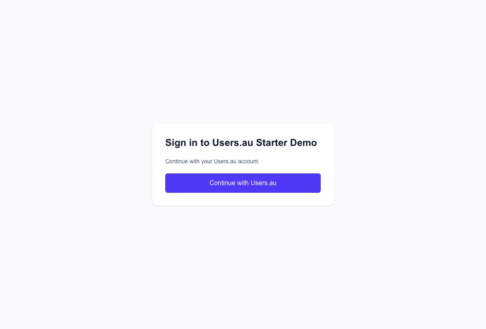

<div align="center">

# Users.au × Next.js Starter Kit

**Hosted authentication. Your application. A practical starting point.**

[Live demo](https://usersau-nextjs-starter.vercel.app) · [AI quick start](#integrate-usersau-into-your-app-with-ai) · [Screenshots](#usersau-in-action) · [Deployment](VERCEL_DEPLOYMENT.md) · [Users.au](https://www.users.au)

[](https://github.com/Users-au/nextjs-starter-kit/actions/workflows/ci.yml) [](https://opensource.org/licenses/MIT) [](https://github.com/Users-au/nextjs-starter-kit/issues) [](https://github.com/Users-au/nextjs-starter-kit/pulls) [](#versions-and-requirements) [](https://usersau-nextjs-starter.vercel.app)

</div>

A Next.js App Router starter with typed minimal sessions, a protected dashboard,
profile API, account management and automatic sign-out.

| 🔐 Connect your identity | 🧩 Build your application | 🛡️ Keep checks on the server |
| --- | --- | --- |
| Users.au OAuth, custom identity domains and profile/avatar support. | Next.js, React, TypeScript and Tailwind, with a working Vercel demo. | Explicit membership admission, safe return URLs and minimal session data. |

## Integrate Users.au into your app with AI

> [!TIP]
> **Open your application repository in an AI coding assistant and paste this
> prompt.** Keep your existing application and let the assistant implement and
> verify the integration.

```text
Integrate Users.au into this application using
https://github.com/Users-au/nextjs-starter-kit as the reference.
Read its README.md, AGENTS.md, docs/AI_IMPLEMENTATION.md and docs/READINESS.md;
inspect this app's versions, auth, routes, environment and deployment conventions.
Preserve its UI/features and use compatible auth APIs; keep provider ID usersau.
Implement /auth/usersau/redirect, /auth/usersau/callback, protected pages/APIs,
profile/avatar/account UI and local sign-out followed by Users.au logout/return.
Keep scopes empty unless registered, preserve state/CSRF checks, validate local
return URLs and stable user IDs, and keep OAuth tokens out of browser sessions.
Enforce membership/role/resource rules on the server. Keep application and identity
origins separate; never invent, commit or print secrets. Report exact callback URLs to register.
Update docs/env examples; run checks, audit, build and auth/access regression tests.
Verify real sign-in/out when credentials are available and identify unverified steps.
Commit and open/update a PR, then report the PR link and validation results.
```

Supply OAuth credentials through private environment configuration. The assistant
can prepare implementation while registration is pending; real authentication
verification needs a registered app. See the [full AI implementation guide](docs/AI_IMPLEMENTATION.md).

## Users.au in action

Users.au hosts the authentication experience on your identity domain. Enable the
sign-in methods available to your project and connect them to your application
through OAuth. These official product screenshots show the hosted experience.

<table>
  <tr><th>🔑 Branded sign-in & social providers</th><th>🛡️ Multi-factor authentication</th></tr>
  <tr>
    <td width="50%"><a href="docs/images/usersau-social.png"></a></td>
    <td width="50%"><a href="docs/images/usersau-mfa.png"></a></td>
  </tr>
</table>

<details>
<summary><strong>👆 Preview the passkey experience</strong></summary>


</details>

[Explore Users.au](https://www.users.au) · [Create a project](https://my.users.au) · [Image sources](docs/images/README.md)

## Live Vercel demo

Try the **[live Users.au starter demo](https://usersau-nextjs-starter.vercel.app)**
to explore sign-in, the protected dashboard, account management and sign-out.

[](https://usersau-nextjs-starter.vercel.app)

Deploy your own app with its own OAuth registration and environment settings;
see the [Vercel deployment guide](VERCEL_DEPLOYMENT.md).

## Documentation

- [AI implementation guide](docs/AI_IMPLEMENTATION.md): workflow, integration
  requirements, configuration contracts and a copyable implementation prompt.
- [Security and verification](docs/READINESS.md): implemented controls, how to
  verify them, and boundaries that business applications must extend.
- [Vercel deployment](VERCEL_DEPLOYMENT.md) and [agent instructions](AGENTS.md).

## Versions and requirements

Use patched Node.js 24.22.1+ (24.x) or 22.23.4+ (22.x); `.nvmrc` and CI use
24.22.1. Older/unsupported runtimes fail installation, startup and build checks
by default. See the [managed-host patch rollout policy](VERCEL_DEPLOYMENT.md#managed-runtime-patch-rollouts)
before considering any temporary Vercel runtime exception.
These minimums include the [October 2026 runtime security fixes](https://nodejs.org/en/blog/vulnerability/october-2026-security-releases).
Dependencies include
Next.js 15.5.28, NextAuth 4.24.15, React 19.3.1, TypeScript 7 (with the TypeScript 6 API compatibility package) and Tailwind CSS 4.
The npm lockfile records exact versions. Use NextAuth **v4** APIs with this code;
Auth.js v5 is a separate migration. Review versions and security advisories when
updating dependencies rather than treating this snapshot as permanently secure.

TypeScript 7 supplies the native `tsc` executable through the
`@typescript/native` npm alias. The `typescript` alias points to Microsoft's
`@typescript/typescript6` compatibility package so ESLint and Next.js can use
the supported JavaScript compiler API. This follows Microsoft's
[side-by-side installation guide](https://devblogs.microsoft.com/typescript/announcing-typescript-7-0/#running-side-by-side-with-typescript-6.0).
`npm run type-check` runs both `tsc` and `tsc6`; production build checks remain
enabled. Keep these aliases together when updating the compiler/tooling.

## Local setup

```bash
git clone https://github.com/Users-au/nextjs-starter-kit.git
cd nextjs-starter-kit
# With nvm installed:
nvm install
nvm use
npm ci
npm run setup
```

Setup copies `env.example` (no leading dot) to a private `.env.local`, generates
`NEXTAUTH_SECRET`, and never overwrites an existing file/secret. Alternatively,
`bash install.sh` runs the lockfile install and setup. Edit the resulting file:

```dotenv
NEXTAUTH_URL=http://localhost:3000
NEXTAUTH_SECRET=use-the-private-value-generated-by-setup
USERSAU_CLIENT_ID=your-real-client-id
USERSAU_CLIENT_SECRET=your-real-client-secret
USERSAU_HOST=https://identity.your-domain.com
USERSAU_SCOPE=
USERSAU_ACCESS_MODE=allowlist
USERSAU_ALLOWED_USER_IDS=42,100
NEXT_PUBLIC_APP_NAME="My Application"
NEXT_PUBLIC_USERSAU_HOST=https://identity.your-domain.com
```

Replace example credentials, domains and IDs. `USERSAU_ACCESS_MODE=allowlist`
allows only the listed stable Users.au IDs. Use `all` deliberately for an app
that accepts any authenticated identity; the shipped env example selects `all`
for the demo. An absent/unknown mode or empty allowlist fails configuration.
This is membership admission, not business roles or tenant authorization.

In the [Users.au console](https://my.users.au), open the project's Integration >
OAuth Management, create an OAuth application and register exactly:

```text
http://localhost:3000/auth/usersau/callback
```

```bash
npm run dev
```

Open `http://localhost:3000`. Development startup validates config before starting
Next.js. Production build validation additionally requires non-loopback HTTPS
origins. Generate/register separate credentials and callbacks per environment.

## Environment contract

| Variable | Meaning |
| --- | --- |
| `NEXTAUTH_URL` | Public **application** origin with local port when applicable. Not the provider or an internal container/service URL. |
| `NEXTAUTH_SECRET` | Private secret of at least 32 characters; preserve across restarts and replicas. |
| `USERSAU_CLIENT_ID` / `USERSAU_CLIENT_SECRET` | Private configuration for this environment's OAuth registration. |
| `USERSAU_HOST` | Identity-provider origin; custom domains supported. No path, query, fragment or credentials. |
| `USERSAU_SCOPE` | Empty by default; set space-separated scopes only when explicitly supported by the OAuth registration. |
| `USERSAU_ACCESS_MODE` | Required explicit `all` or `allowlist` admission policy. |
| `USERSAU_ALLOWED_USER_IDS` | Comma-separated stable identity IDs, required for allowlist mode. Not email addresses. |
| `NEXT_PUBLIC_USERSAU_HOST` | Public identity origin, required to match `USERSAU_HOST`; never the app origin. |
| `NEXT_PUBLIC_APP_NAME` | Browser-visible display name. Also customize static metadata in `src/app/layout.tsx`. |

The registered callback is `${NEXTAUTH_URL}/auth/usersau/callback`. Origin
validation rejects placeholders, embedded credentials and unsafe URLs; HTTP
loopback is allowed only outside production. Trailing `/` is normalized.

`NEXT_PUBLIC_*` values are browser-visible and generally fixed when Next.js
builds client code. Never place secrets there; rebuild when public values change.
The dashboard/account actions receive the validated identity origin from the
server. See [Next.js environment variables](https://nextjs.org/docs/15/app/guides/environment-variables).

Requesting a scope that is not configured for the OAuth application can cause an
`invalid_scope` failure. Empty scope deliberately remains an explicit
`scope: undefined` in provider config, avoiding an underlying default `openid`
scope. Tests inspect the real NextAuth-generated request so refactors cannot
silently change this contract.

## Authentication and server access

Provider ID `usersau` uses `/oauth/authorize`, `/oauth/token` and `/api/user`.
Profiles normalize IDs to string `usersauId` and select a usable HTTP(S) image
from `avatar`, `image`, then `picture`. Missing/invalid identities are rejected.

The JWT and browser session contain only identity/profile/session fields. OAuth
access/refresh tokens are not retained or returned. Legacy token fields are
removed when a JWT is updated. The starter does not call provider APIs after
login and therefore does not need token refresh/storage/revocation features.

`getAuthorizedSession()` in `src/lib/server-auth.ts` checks a server session and
the current ID policy on each call. Dashboard layout **and page** use it via
`requireUser()`, while `/api/profile` independently returns 401/403 for rejected
requests. Updating the allowlist rejects old sessions on subsequent server
checks. Middleware only improves navigation and matches `/dashboard/:path*`.

For every new private Route Handler, Server Action or data read/write, call the
server helper and enforce the application's resource/role/tenant policy before
accessing data. The client `ProtectedRoute` is a presentation wrapper, not an
authorization boundary. See [NextAuth server sessions](https://next-auth.js.org/configuration/nextjs)
and [Next.js authorization](https://nextjs.org/docs/15/app/guides/authentication).

Login preserves same-origin return path/query and rejects external/encoded
redirect tricks and auth/API loops. Errors show safe messages, configuration
variable names and retry controls without credentials or raw provider responses.

The public authentication endpoints are:

| Endpoint | Behavior |
| --- | --- |
| `/auth/usersau/redirect` | Starts sign-in automatically in the browser using NextAuth's CSRF-protected POST. Accepts a validated local `callbackUrl`; JavaScript is required. |
| `/auth/usersau/callback` | Receives Users.au's OAuth response. Register this exact app URL; authorization and token exchange use the same URI and verify OAuth state. |
| `/logout` | Starts sign-out automatically with no confirmation. A CSRF-verified POST clears the local session, visits Users.au `/logout?continue=…`, then returns to the app's `/auth/login`. JavaScript is required for the GET entry. |

NextAuth's internal `/api/auth/*` routes still provide sessions, CSRF and the
sign-in engine. When upgrading an older starter, replace the registered
`/api/auth/callback/usersau` callback with `/auth/usersau/callback` and redeploy
the application together. Do not merely add a redirect between callback URLs:
the token exchange must use the originally registered URI.

Account links open the provider's `/account`. Sign-out awaits local NextAuth
sign-out before visiting provider `/logout`, with retry on failure. The verified
Users.au `continue` parameter returns to the configured app's `/auth/login`;
request input cannot change this destination. The automatic GET entry accepts
same-origin or direct browser navigation and rejects cross-site initiation.
If the identity service returns to the registered app `/logout` instead, a
short-lived HttpOnly cookie completes that return at `/auth/login` without
restarting remote logout. The return shortcut is unavailable while a local
session cookie remains.
This clears the two sessions without inventing token revocation APIs. See the
[official Users.au logout implementation](https://github.com/Users-au/laravel-client/blob/main/src/Http/Controllers/AuthController.php).

## Files and commands

| Path | Responsibility |
| --- | --- |
| `src/lib/auth.ts` | Lazy validated NextAuth v4 options, provider and callbacks |
| `src/lib/auth-config.ts` | Shared strict env validation |
| `src/lib/auth-policy.ts` / `server-auth.ts` | Profile/identity policy and server access enforcement |
| `src/lib/auth-urls.ts` | Safe callbacks and route-boundary matching |
| `src/app/api/profile/route.ts` | Protected server API example |
| `src/types/next-auth.d.ts` | Session, User and JWT types |
| `src/app/globals.css` | Tailwind 4 theme and local system font stack |
| `tests/` / `integration/` | Unit/security and production-server checks |

| Command | Purpose |
| --- | --- |
| `npm ci` / `npm run setup` | Reproducible install / safe initial private env creation |
| `npm run dev` | Validate development config and start Turbopack |
| `npm run lint` / `npm run type-check` | Direct ESLint with zero warnings / TypeScript 7 and 6 compatibility checks |
| `npm test` | Unit/security regression tests; no real credentials needed |
| `npm run check` | Lint, types and unit tests |
| `npm run build:check` | Load production Next.js env files and validate without printing values |
| `npm run build` | Validate configuration and build; no remote font download required |
| `npm run test:integration` | Start the built production server with non-secret fixtures and exercise access/session/OAuth request checks |
| `npm run start` | Run the previously built Next.js app; inject its production env |
| `npm audit --audit-level=low` | Audit both production and development dependency vulnerabilities |

The integration test requires a successful build first and a local listening
socket. CI runs audit, checks, production build and integration tests with
non-secret fixtures. See [verification details](docs/READINESS.md).

## Choose your integration

| Project | Use it when you want to… |
| --- | --- |
| [**Next.js starter — this repo**](https://github.com/Users-au/nextjs-starter-kit) | Start a Next.js app with server-managed OAuth sessions and a protected dashboard. |
| [Laravel starter](https://github.com/Users-au/laravel-starter-kit) | Start a Laravel app with Blade templates and Users.au integration. |
| [Laravel client](https://github.com/Users-au/laravel-client) | Add local user synchronization and authentication routes to a Laravel app. |
| [Socialite provider](https://github.com/Users-au/socialite-provider) | Connect an existing Laravel Socialite authentication flow to Users.au. |
| [Frontend client](https://github.com/Users-au/frontend-client) | Use public-client OAuth with PKCE in JavaScript, Vue or React. |

## Contributing and delivery

Use a feature branch, commit and push task changes, and open/update a PR with the
problem, behavior and verification outcomes. Fixes to both this starter and a
consumer need a PR link for **each** repo. Pushing a branch alone is not delivery.
Merging a PR does not authorize production deployment.

## License and support

[MIT](https://opensource.org/licenses/MIT). Contact
[opensource@users.au](mailto:opensource@users.au) or open a GitHub issue.
